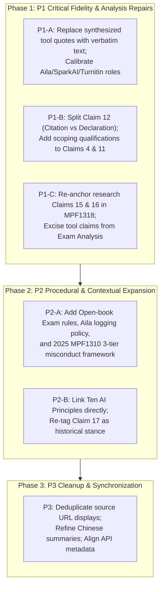

# The University of Melbourne (QS 2026 #19) Independent Evidence Audit

- **Institution**: The University of Melbourne (`university-of-melbourne`)
- **QS 2026 Rank**: 19
- **Audit Date**: 2026-10-17
- **Audit Mode**: Read-Only Evidence Audit (只读审计 · 先不上线)
- **Current Audit Verdict**: **PARTIAL** (暂不通过完整验收，保留现有参考页面，待 P1 项修复后复验)
- **Baseline Scope**: 21 Claims (2026-07-18 baseline), 6 official source entries (5 distinct URLs, 2 snapshots of T&L FAQ), 3 tool records, 6 supplementary procedure facts (2026-10-08 collection).
- **Public Entry Points**:
  - [English Page](https://eduaipolicy.org/universities/university-of-melbourne)
  - [Chinese Page](https://eduaipolicy.org/zh/universities/university-of-melbourne)
  - [University Public JSON](https://eduaipolicy.org/api/public/v1/universities/university-of-melbourne.json)
  - [Analysis Public JSON](https://eduaipolicy.org/api/public/v1/analysis/universities/university-of-melbourne.json)

---

## 1. Executive Summary & Audit Baseline

Following the independent audit of UC Berkeley (QS 2026 =17, tied with Tsinghua), this audit reviews the next institution in the QS 2026 ranking table: **The University of Melbourne** (QS 2026 #19).

The audit cross-examines two distinct data layers:
1. **Core 21 Claims & 6 Official Sources**: Published on 2026-07-18 under `agent_reviewed` status with strong snapshot baseline.
2. **Supplementary Procedural Facts (2026-10-08)**: 6 structured enforcement facts in V5 content covering student AI declaration, Turnitin investigative limits, MPF1310 scope, Copilot Chat conditions, and MPF1323 appeals timeline.

### Overall Audit Verdict: **PARTIAL**
While the university's broad direction (course-level authorization, unapproved use as potential misconduct, privacy cautions, non-determinative Turnitin scores) is validated by official policy, significant defects exist in **evidence fidelity**, **policy hierarchy**, **tool audience boundaries**, and **analysis categorization**. In particular, the examination dimension exhibits the identical structural category error observed at Berkeley before repair.

---

## 2. Synthesis of UC Berkeley Lessons Applied to Melbourne

| Berkeley Lesson | Problem Manifestation at Melbourne | Audit & Remediation Strategy |
| :--- | :--- | :--- |
| **1. Tool Licensing $\ne$ Exam Permission** | Analysis API maps 3 tools + Claim 11 to `exams`, sets status to `required`, and leaks raw tool dictionary into `normalizedValue`. | Excised tool claims from exam derivation. Introduce dedicated exam guidance from *Open-book exams* (check GenAI permission, permitted tools, and scope). |
| **2. Precise Terminology: Citation vs. Declaration** | Claim 12 conflates citing AI text with declaring AI preparatory assistance as a single obligation. | Split obligations: **Citation** applies when quoting/paraphrasing AI output in references; **Declaration** applies to process uses (planning, brainstorming, editing). |
| **3. Policy Hierarchy & Primary Authority** | Claims 15 & 16 rely on a 2023 Parliamentary Submission PDF rather than binding internal policy. | Re-anchor research claims to MPF1318 (*Responsible Conduct of Research*, cl. 5.11) and current research guidance. Relegate 2023 submission to historical context. |
| **4. Exact Verbatim Quotation Integrity** | 3 tool Claim snippets begin with synthesized text: `"The University of Melbourne says..."`. | Replace paraphrased strings with exact continuous verbatim quotes from official pages; move summaries into `claimText` or notes. |
| **5. Audience Scope Disentanglement** | Claim 11 (SparkAI testing) and tool records blur student vs. staff boundaries. | Explicitly tag audience: SparkAI is staff-only internal platform; Aila is LMS course-conditional; Turnitin is an educator assessment/investigative tool. |
| **6. Procedure Evolution & Sanction Framework** | Misconduct claims omit the 2025 revision of MPF1310 distinguishing minor practice from misconduct. | Incorporate 2025 MPF1310 framework: *Poor Academic Practice* (non-punitive/educative) vs. *Level 1* (Faculty) vs. *Level 2* (University-wide Serious Misconduct). |
| **7. Student Privacy & Logging Visibility** | Privacy focuses only on data upload prohibition; omits AI interaction logging rules. | Document Aila logging: chats encrypted in SparkAI/LMS, teachers cannot view regular chats, anonymous course stats, accessible for formal integrity investigations. |
| **8. Read-Only Audit & Deployment Gate** | Audit must not trigger unverified code pushes or unmeasured cutovers. | Strictly enforce read-only status (`先不上线`). Retain original Claim IDs, record gaps, preserve held decisions. |

---

## 3. Detailed Audit Findings by Severity

### Priority P1: Substantive Evidence, Scope & Attribution Defects

#### P1-1. Tool Paraphrasing Presented as Verbatim "Original Evidence"
- **Affected Objects**:
  - `cl-the-university-of-melbourne-institutional-ai-service-147` (AILA)
  - `cl-the-university-of-melbourne-institutional-ai-service-148` (SparkAI)
  - `cl-the-university-of-melbourne-turnitin-ai-detection-149` (Turnitin)
- **Current Defect**: `evidenceSnippet` in all three claims begins with `"The University of Melbourne says..."`. These are synthetic summaries rather than verbatim continuous extracts from the official source page (`melbourne-cshe.unimelb.edu.au`).
- **Remediation**:
  - Preserve original Claim IDs.
  - Move descriptive summaries into `claimText` or structured notes.
  - Extract exact contiguous verbatim sentences from the official HTML snapshot for `evidenceSnippet`.

#### P1-2. Tool Status & Audience Conflation
- **Current Defect**: Tool catalog marks AILA, SparkAI, and Turnitin as "Official recommendation", creating misleading impressions for students:
  - **Aila**: Not universally available; only accessible to students if a subject coordinator explicitly activates it in an LMS Canvas subject.
  - **SparkAI**: An internal staff platform; students do not have direct access.
  - **Turnitin AI detection**: An educator/investigative diagnostic, not an endorsed generative tool for students.
- **Remediation**:
  - Classify Aila as `conditionally_allowed` (course-conditional learning assistant).
  - Classify SparkAI with `audience: staff`.
  - Classify Turnitin as an administrative/investigative detection tool.
  - Update Aila's timeline from the legacy 2025 trial description to the current 2026 course pilot deployment.

#### P1-3. Conflation of Citation and Declaration (Claim 12)
- **Affected Object**: `claim-university-of-melbourne-12`
- **Current Text**: *"University of Melbourne students must appropriately cite any use of GenAI tools in the preparation of assessment submissions."*
- **Source Ground Truth**: Melbourne's *Academic Integrity* guide explicitly separates:
  1. **Citation & Referencing**: Required when an AI output is directly quoted or paraphrased in the text.
  2. **Acknowledgement / Declaration**: Required when AI is used for process assistance (e.g., brainstorming, outlining, proofreading, editing).
- **Remediation**: Split into two distinct claims or refine Claim 12 to specify the dual citation/declaration trigger conditions, matching the 2026-10-08 procedural supplementary record (`university-of-melbourne-bing-ninth-v5-01/02`).

#### P1-4. Research Rules Based on Outdated Parliamentary Submission (Claim 15 & 16)
- **Affected Objects**: `claim-university-of-melbourne-15`, `claim-university-of-melbourne-16`
- **Current Source**: `sc-melbourne-004` (July 14, 2023 University Submission to Australian Federal Inquiry).
- **Defect**: An external parliamentary submission expresses advocacy and high-level stance; it is not the primary governing policy document for current campus research conduct.
- **Source Ground Truth**:
  - Primary Policy: *Responsible Conduct of Research Policy* (MPF1318), specifically Clause 5.11.
  - Operational Guide: *Responsible Use of AI in Research*, addressing record-keeping of digital tools, collaborator disclosure, security/ethics review, verification of research integrity, and thesis-specific constraints.
  - Thesis Restriction: Graduate research thesis editing is strictly confined to grammar, spelling, and clarity, differing from broader general research publication terms.
- **Remediation**: Re-ground Claim 15 & 16 in MPF1318 and the active research guide. Retain the 2023 submission solely as secondary background evidence.

#### P1-5. Examination Category Error in Analysis Engine
- **Affected Surface**: `api/public/v1/analysis/universities/university-of-melbourne.json`
- **Current Defect**:
  - Maps 3 tool claims (`cl-...-147`, `cl-...-148`, `cl-...-149`) and Claim 11 to the `exams` dimension.
  - Leaks raw tool dictionary into `normalizedValue`: `{"tool":"institutional_ai_service","rawToolName":"AILA",...}`.
  - Sets exam status to `required`.
- **Ground Truth**: Campus tool availability does not constitute exam authorization. Melbourne's official *Open-book exams* policy requires students to check whether GenAI is permitted for each specific examination, which tools are authorized, and what specific uses are allowed.
- **Remediation**:
  - Remove all tool claims from the exam basis.
  - Re-derive exam dimension from course/exam-specific rules.
  - Add dedicated claim for *Open-book exams* guidelines.

---

### Priority P2: Scope Calibration, Procedure Gaps & Metadata

#### P2-1. Scope Over-generalization in Claims 4 and 11
- **Claim 4**: States students must produce assessed text/code/images themselves without GenAI.
  - *Calibration*: Official teaching guidelines permit instructors to design assessments where students collaborate with AI or where AI produces partial components. Must append: *"subject to specific assessment instructions and learning outcomes."*
- **Claim 11**: States materials can only be tested in SparkAI.
  - *Calibration*: Source explicitly allows testing in *"other University of Melbourne-sanctioned platforms."* Furthermore, this rule applies to staff handling teaching IP, not students. Must append exception and set `audience: staff`.

#### P2-2. 2025 Academic Integrity Procedure Classification (MPF1310)
- **Current Defect**: Claims refer broadly to misconduct under MPF1310 without reflecting the 2025-01-01 revision.
- **Ground Truth**: MPF1310 now establishes a formal three-tier framework:
  1. **Poor Academic Practice**: Minor, non-intentional practice issues that do not undermine assessment integrity; resolved educatively without a formal misconduct finding.
  2. **Level 1 Academic Misconduct**: Departmental/Faculty-level resolution.
  3. **Level 2 Serious Academic Misconduct**: Central university investigation and committee hearing.
- **Remediation**: Add a dedicated procedural claim capturing the three-tier framework, preventing students from conflating minor formative drafting issues with severe disciplinary charges.

#### P2-3. AILA Student Interaction Logging & Privacy Rules
- **Current Defect**: Privacy claims only cover general prohibitions against uploading personal/confidential data.
- **Ground Truth**: Melbourne's *AILA Student FAQ* provides critical transparency:
  - Chats are stored securely and encrypted in SparkAI / Canvas LMS.
  - Instructors cannot routinely read individual student chat transcripts.
  - Course coordinators may access de-identified, aggregated analytics.
  - Detailed transcripts may only be released for formal academic misconduct investigations.
- **Remediation**: Add a specific tool-privacy claim detailing Aila interaction logging, access controls, and investigation triggers.

#### P2-4. Disentangling Policy Background from Operational Rules (Claims 14, 17, 18)
- **Claim 14**: Currently references the announcement of a graduate statement rather than the operational rules within it. $\rightarrow$ Extract substantive rules.
- **Claim 17**: 2023 government policy recommendations. $\rightarrow$ Re-tag as historical policy position.
- **Claim 18**: Cites MSD faculty guidelines to prove university-wide AI principles. $\rightarrow$ Link directly to the university's official *Ten AI Principles* document.

---

### Priority P3: Publication Consistency, Deduplication & Localization

#### P3-1. Source Count Deduplication
- **Observation**: Official source count displays as 6, but represents 5 distinct URLs:
  - `sc-melbourne-002` and `sc-the-university-of-melbourne-380004250999` share the identical URL: `https://melbourne-cshe.unimelb.edu.au/resources/topics/assessment-and-feedback/specific-help/ai-in-teaching-and-learning`.
- **Remediation**: Distinguish source URL count (5) from snapshot artifact count (6).

#### P3-2. Unified Source Type Attribution
- **Observation**: `officialSources` correctly tags `official_guidance` and `official_pdf`, but internal attribution fields in some claims homogenize to `official_policy_page`.
- **Remediation**: Align internal attribution `sourceType` with top-level official source metadata.

#### P3-3. Chinese Translation Fidelity
- **Observation**: Chinese topic cards retain untranslated English policy summaries.
- **Remediation**: Provide verified Chinese summaries for student cards while strictly preserving verbatim English source text in evidence blocks.

---

## 4. Validated Findings (Retained As-Is)

The following baseline findings are thoroughly verified against active 2026 official guidance and should be preserved in full:
1. **Assessment Discretion**: GenAI permissibility is determined at the subject and task level by the Subject Coordinator.
2. **Academic Misconduct Linkage**: Unauthorized or undisclosed GenAI usage constitutes academic misconduct under MPF1310.
3. **Data Security & Privacy**: Students and staff must not upload confidential, sensitive, or third-party copyright materials to public AI tools.
4. **Turnitin AI Score Limitations**: Turnitin AI writing detection percentages are investigative indicators only; they never constitute standalone proof of misconduct.
5. **Human Pedagogical Judgment**: AI tools must never substitute for evaluative academic judgment in marking and grading.
6. **Student Appeals Window**: Formal appeals under MPF1323 must be lodged within 20 University business days of the original decision notice.

---

## 5. Remediation Roadmap & Execution Sequencing

When authorized to implement repairs, execution should proceed strictly according to the following phased sequence:

### Strict Gate & Release Commitments
- **Read-Only Status**: This audit authorizes **NO** build, deployment, service restart, cutover, or public notification.
- **ID Stability**: All 21 original Claim IDs (`claim-university-of-melbourne-1` to `21`) and 3 tool IDs will be retained throughout future repairs.
- **Snapshot Policy**: Existing `needs_review` / strong snapshot boundaries and review holds are preserved.
- **Audit Verdict**: Remains **PARTIAL** until all P1 issues are resolved, locally verified, and accepted through formal synchronization gates.
